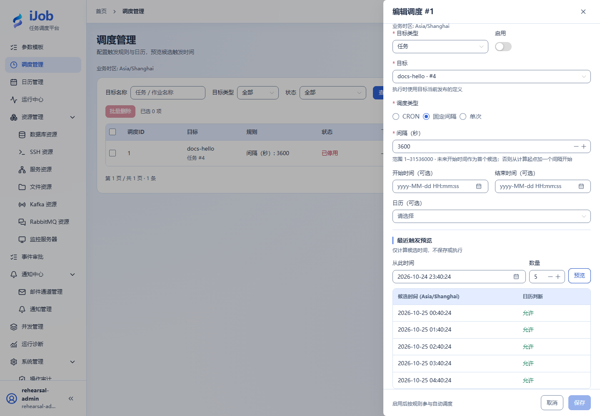

# 调度配置、预览与补发

[English](../../en/user-guide/schedules.md) · [手册首页](../README.md)

## 入口与操作路径

调度管理 → 新增调度。页面动作随当前账号权限提供；先确认操作对象及环境。

## 配置和动作说明

| 字段/动作 | 用途与填写规则 |
| --- | --- |
| `目标类型/目标` | 选择任务或作业；实际受理使用目标当前发布版本。 |
| `CRON / INTERVAL / ONCE` | CRON 为秒 分 时 日 月 周六段；间隔以秒计；单次必须有有效时间。 |
| `业务时区 / 开始结束 / 日历` | 业务时区由后台提供，区别于顶部显示时区；有效期与日历共同过滤。 |
| `变量 / 参数模板` | 保存当前参数快照，之后修改模板不自动更新调度。 |
| `错过策略 / 宽限 / 补发上限 / 排队期限` | 可继承后台默认或单独覆盖；排队期限从计划触发时点计，不是执行超时。 |
| `预览 / 启用` | 预览只计算候选，不保存/执行；启用后参与自动调度。修改条件后重新预览。 |

## 操作与结果核对

入门选 docs-hello、INTERVAL=3600，保持停用，预览 5 个候选并核对时区与日历。需要真实触发时在可控窗口启用，验证触发记录→实例→结果后停用。没有候选先查有效期和日历，不用盲目缩短间隔。

## 真实页面示例

停用调度的 5 个候选时间；只是预览，没有启用自动运行。

