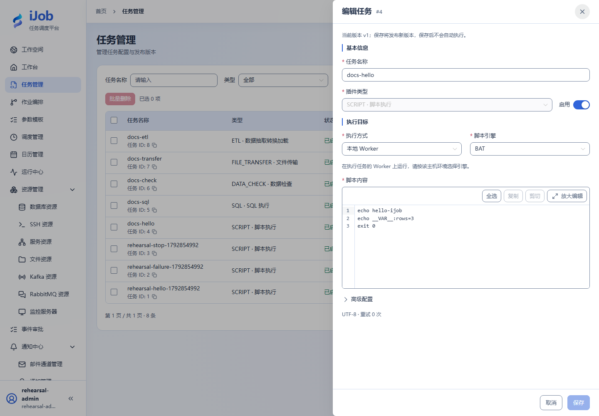

# 任务：公共配置与版本

[English](../../en/user-guide/tasks.md) · [手册首页](../README.md)

## 入口与操作路径

任务 → 新增任务/编辑。页面动作随当前账号权限提供；先确认操作对象及环境。

## 配置和动作说明

| 字段/动作 | 用途与填写规则 |
| --- | --- |
| `name / description` | 名称便于查询；说明记录业务用途与外部副作用。 |
| `pluginType / pluginConfig` | 选择 11 种插件之一并完成对应表单；详见插件手册。 |
| `retryTimes / retryInterval / timeout` | 重试次数、间隔秒和执行超时秒；入门重试 0、间隔 1、超时 60。先评估重复写入。 |
| `enabled / groups` | 启用状态及执行分组，最多 16 个；分组需与 Worker 匹配，不是账号分组。 |
| `保存 / 版本` | 保存发布首个/下一个版本，不自动运行；查看历史以核对实际定义。 |
| `执行 / 更多操作` | 执行创建触发请求；查看实例才知道结果。并发策略单独维护，不发布任务版本。 |

## 操作与结果核对

先创建 [SCRIPT](plugins/script.md) 的 docs-hello，保存后点击执行，在参数弹窗确认。任务更新不会改写已经发布作业内绑定的旧版本；要采用新子任务版本需重新发布父作业。提交结果不确定时先查询最新版本，避免重复保存。

## 真实页面示例

已保存的 SCRIPT 表单；保存发布新版本，不自动执行。

